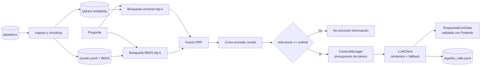

# Hybrid RAG Pipeline

Asistente que responde preguntas sobre la documentación interna del equipo de operaciones de una empresa mediana (runbooks, SLAs de proveedores, políticas) combinando búsqueda semántica y léxica, con respuestas citadas.

## Objetivo

Construir un sistema de *Retrieval-Augmented Generation* que combine búsqueda semántica (vectorial) y búsqueda léxica (BM25), fusione ambos rankings con Reciprocal Rank Fusion (RRF), los reordene con un cross-encoder y genere respuestas que citan la fuente exacta.

## Conceptos clave

Embedding Models, Vector DBs (Qdrant), BM25, Reciprocal Rank Fusion (RRF), Reranking con Cross-Encoders, Chunking, Citas y grounding.

## Por qué importa

Sienta las bases de la ingesta y recuperación de conocimiento empresarial con alta precisión. La búsqueda vectorial puede fallar con códigos, nombres propios y siglas (`T-1042`, `ERP`, `SLA-B`); BM25 falla con paráfrasis. El híbrido cubre ambos casos y se demuestra con métricas, no con impresiones.

## Resultados

Corpus de 32 documentos ficticios (103 chunks) y 40 preguntas: 13 léxicas (códigos y nombres), 15 semánticas (paráfrasis), 8 mixtas y 4 sin respuesta en el corpus. CPU, `k=5`, `TOP_K_CANDIDATES=20`.

| Estrategia | recall@5 | hit@5 | MRR | recall léxicas | recall semánticas | recall mixtas | latencia prom |
|---|---|---|---|---|---|---|---|
| `vector` | 0.935 | 0.972 | 0.880 | 0.974 | 0.900 | 0.938 | 25 ms |
| `bm25` | 0.773 | 0.806 | 0.663 | 0.872 | 0.567 | 1.000 | 28 ms |
| `hybrid` | 0.935 | 0.972 | 0.808 | 0.974 | 0.900 | 0.938 | 31 ms |
| `hybrid_rerank` | **0.963** | **1.000** | **0.944** | 0.974 | **0.967** | 0.938 | 6119 ms |

Lectura:

- BM25 se cae con paráfrasis (0.567 en semánticas) y es perfecto en las mixtas, donde la pregunta repite términos del documento.
- Con `multilingual-e5-small` la búsqueda vectorial resuelve casi todos los códigos de este corpus; la fusión RRF sin reranker no mejora el recall y baja el MRR porque mezcla el ruido de BM25.
- El cross-encoder es lo que mueve la aguja: todas las preguntas tienen al menos un chunk correcto en el top 5 y el chunk correcto queda primero en la mayoría. Su costo es la latencia en CPU (unos 6 s por pregunta con `bge-reranker-v2-m3` y 20 candidatos).

### Umbral de "no encontré información"

| Estrategia | relevancia con respuesta (min-max) | relevancia sin respuesta (min-max) | con respuesta que pasan | sin respuesta rechazadas |
|---|---|---|---|---|
| `vector` / `bm25` / `hybrid` (coseno) | 0.867 (0.813-0.921) | 0.835 (0.822-0.844) | 36/36 | 0/4 |
| `hybrid_rerank` (cross-encoder) | 0.601 (0.000-1.000) | 0.003 (0.000-0.007) | 34/36 | 4/4 |

Los cosenos de E5 viven en una franja estrecha y se traslapan: no hay umbral que separe preguntas con y sin respuesta, así que en esas estrategias el filtro lo hace el LLM (`encontrado=false`). El score del cross-encoder sí separa: con `MIN_RELEVANCE=0.01` se rechazan las 4 preguntas sin respuesta sin llamar al LLM. Ojo: el umbral se calibró sobre este mismo dataset con solo 4 negativos; con un corpus real hay que recalibrarlo con `--verbose`.

### Respuestas generadas (`hybrid_rerank`)

| Métrica | Valor |
|---|---|
| Preguntas con respuesta contestadas | 33/36 |
| ...que citan un chunk esperado | 33/36 |
| Preguntas sin respuesta rechazadas | 4/4 |
| Citas que no pasaron el validador (tras reparaciones) | 0 |
| Costo total de las 40 preguntas | $0.013 |

Dos de las tres preguntas no contestadas las bloqueó el umbral (paráfrasis con score de reranker < 0.01); en la tercera el LLM decidió que el contexto no bastaba. Durante la corrida Groq respondió 65 veces con errores transitorios (límite de tasa) y el cliente hizo fallback a Gemini en 16 preguntas sin perder ninguna.

## Qué se construye por bloque

| Bloque | Qué agrega |
|---|---|
| 1. Núcleo | Cliente LLM multi-proveedor con reintentos, fallback, costo por llamada y log JSONL |
| 2. Ingesta | Carga de Markdown/PDF, chunking por secciones con solapamiento, metadatos (fuente, sección, fecha) |
| 3. Recuperación | Índice vectorial + índice BM25, fusión RRF y reranking con cross-encoder |
| 4. Generación | Prompt versionado con contexto presupuestado; respuesta estructurada con citas validadas |
| 5. Evaluación | Dataset de preguntas, recall@k y MRR por estrategia, fidelidad de las citas |

## Stack

- Python 3.11+, [uv](https://docs.astral.sh/uv/)
- Pydantic v2, pydantic-settings, httpx, Jinja2, PyYAML, PyMuPDF
- Qdrant en modo embebido (`qdrant-client`, sin servidor)
- `rank-bm25`
- `sentence-transformers`: `intfloat/multilingual-e5-small` (embeddings) y `BAAI/bge-reranker-v2-m3` (cross-encoder). Se eligieron modelos multilingües porque el corpus está en español; ambos se cambian en `.env`.
- pytest, ruff

## Arquitectura



| Archivo | Responsabilidad |
|---|---|
| `core/config.py` | `Settings` leída de `.env`; valida llaves, chunking y `top_k` al arrancar |
| `core/llm_client.py` | Cliente con backoff, fallback entre proveedores y `log_extra` |
| `core/providers.py` | Adaptadores Gemini, Groq y Ollama sobre la API compatible con OpenAI |
| `core/logger.py` / `core/pricing.py` | Log JSONL por intento (con `retrieval_strategy` y `chunk_ids`) y costo por llamada |
| `ingest/loaders.py` | Markdown con front-matter y PDF (encabezados reconstruidos por tamaño de fuente) |
| `ingest/chunker.py` | Chunking por encabezados con tamaño y solapamiento; `chunk_id` determinista `{doc}#{seccion}` |
| `retrieval/embeddings.py` | Protocolos `Embedder`/`PairScorer` e implementaciones con `sentence-transformers` (carga perezosa) |
| `retrieval/vector_store.py` | Indexación y búsqueda vectorial en Qdrant |
| `retrieval/bm25.py` | Tokenizador que conserva códigos (`t-1042`) e índice BM25 |
| `retrieval/fusion.py` | `reciprocal_rank_fusion(rankings, k=60)` |
| `retrieval/reranker.py` | Reordenamiento con cross-encoder |
| `retrieval/retriever.py` | Las cuatro estrategias y la `relevance` para el umbral |
| `retrieval/index.py` | `build_index` y `load_retriever` (Qdrant + `chunks.jsonl`) |
| `retrieval/metrics.py` | recall@k, hit@k y MRR |
| `context/manager.py` | Presupuesto de tokens por sección; los chunks peor rankeados se descartan primero |
| `contracts/answer.py` | `RespuestaConCitas` con validador: cada cita existe en el contexto y su fragmento aparece textual |
| `contracts/structured_output.py` | `generate_structured`: JSON validado con Pydantic, reparación y `validation_context` |
| `prompting/promptkit.py` / `prompts/` | Prompts YAML versionados (`rag_answer/v1.yaml`) |
| `generation/rag.py` | `RAGAssistant.ask`: recupera, aplica el umbral, arma el contexto y genera |
| `scripts/generate_docs.py` | Genera el corpus ficticio (29 Markdown + 3 PDF) y `data/eval_questions.jsonl` |
| `scripts/eval_retrieval.py` | Compara estrategias, calibra umbrales y (con `--answers`) mide fidelidad de citas |
| `scripts/report.py` | Costo, latencia, fallback y desglose por estrategia desde el log |
| `tests/` | 93 pruebas sin red ni modelos (fakes de proveedor, embedder y cross-encoder) |

## Comandos

```bash
uv sync                      # en OneDrive: uv sync --link-mode=copy
cp .env.example .env         # llena GROQ_API_KEY y/o GEMINI_API_KEY

# Corpus ficticio y dataset de evaluación (ya incluidos en data/)
uv run scripts/generate_docs.py

# Indexa la documentación de data/docs (descarga el modelo de embeddings la primera vez)
uv run main.py ingest

# Pregunta (por defecto hybrid_rerank)
uv run main.py ask "¿Cuál es el SLA del proveedor de enlaces?"
uv run main.py ask --strategy vector "..."
uv run main.py ask --strategy bm25 "¿Qué es el ticket T-1042?"
uv run main.py ask --provider ollama "..."

# Evaluación de recuperación (y de respuestas, con llamadas reales al LLM)
uv run scripts/eval_retrieval.py --strategies vector bm25 hybrid hybrid_rerank --k 5
uv run scripts/eval_retrieval.py --strategies hybrid_rerank --verbose
uv run scripts/eval_retrieval.py --answers --answer-strategy hybrid_rerank

uv run scripts/report.py
uv run pytest -q
uv run ruff check .
```

Ejemplo de salida:

```text
El SLA del proveedor de enlaces (NetLink) establece una disponibilidad mensual del 99.7 % por circuito y obliga a responder en 30 minutos ante fallas totales.
  [SLA-B#disponibilidad] «Disponibilidad mensual comprometida de 99.7 % por circuito, medida por el monitoreo del proveedor y validada contra el nuestro.»
  [RB-02#reporte-al-proveedor] «El contrato SLA-B obliga a NetLink a responder en 30 minutos para fallas totales.»
  hybrid_rerank · relevancia 0.505 (reranker, umbral 0.01) · chunks RB-02#reporte-al-proveedor, SLA-B#disponibilidad, ... · 1 llamadas · 868/458 tokens · 1733 ms · $0.000405
```

## Capacidades verificadas

- 93 pruebas automatizadas sin red ni modelos y análisis estático limpio con Ruff.
- Corpus sintético reproducible de 32 documentos, 103 chunks y 40 preguntas etiquetadas.
- Recall@5 de 0.963, hit@5 de 1.000 y MRR de 0.944 con recuperación híbrida y reranking.
- Las 4 preguntas sin respuesta se rechazaron antes de llamar al LLM mediante un umbral
  calibrado del cross-encoder.
- 33 de 36 respuestas contestables citaron uno de los chunks esperados.
- Ninguna cita inválida superó el contrato después de las reparaciones.
- El validador exige que cada `chunk_id` exista en el contexto y que el fragmento citado
  aparezca de forma textual.
- La telemetría registra estrategia, chunks, proveedor, tokens, latencia y costo sin
  guardar el contenido de la pregunta.
- La evaluación completa de 40 respuestas costó $0.013 con fallback automático entre
  proveedores.

## Notas de diseño

- **Dos umbrales.** `MIN_RELEVANCE` aplica al score del cross-encoder (0-1) y `MIN_VECTOR_SIMILARITY` al coseno del mejor resultado vectorial; los scores de BM25 y RRF no están calibrados y no sirven para decidir.
- **Citas verificables.** El validador recibe los chunks que realmente quedaron en el contexto (después del presupuesto de tokens) y exige que el fragmento aparezca textual. Si el modelo inventa un `chunk_id` o parafrasea, `generate_structured` le devuelve el error y repara.
- **`chunk_id` determinista.** Se deriva del documento y del encabezado, así que el dataset de evaluación sobrevive a reindexaciones mientras no cambien los títulos de sección.
- **Windows.** En carpetas de OneDrive `uv` no puede usar hardlinks: usa `--link-mode=copy` o `UV_LINK_MODE=copy`. Smart App Control puede bloquear la primera carga de algunas DLL de scikit-learn; un segundo intento las carga.

## Diseño y componentes reutilizables

El proyecto separa proveedores, recuperación, contexto y generación para que cada capa
pueda evaluarse o sustituirse de forma independiente:

- `core/llm_client.py`: reintentos y fallback multi-proveedor (Gemini, Groq, Ollama)
- `core/logger.py` y `core/pricing.py`: costo y latencia por llamada
- `contracts/structured_output.py`: Pydantic más reparación
- `prompting/promptkit.py`: prompts YAML versionados
- `context/manager.py`: presupuesto de tokens por sección para el contexto recuperado
- `retrieval/`: índices vectorial y BM25, fusión RRF, reranking y métricas desacopladas
- `generation/rag.py`: orquestación del umbral, contexto y respuesta con citas verificables
