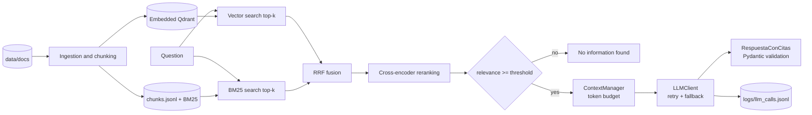

# Hybrid RAG Pipeline

A production-oriented assistant that answers questions about an operations team's internal
documentation—runbooks, vendor SLAs, and policies—using hybrid retrieval and verifiable citations.

## Goal

Combine semantic vector search and lexical BM25 retrieval, merge their rankings with Reciprocal
Rank Fusion (RRF), rerank candidates with a cross-encoder, and generate grounded answers that cite
the exact source passages.

## Why it matters

Vector search can miss codes, proper names, and acronyms such as `T-1042`, `ERP`, and `SLA-B`;
BM25 struggles with paraphrases. Hybrid retrieval covers both cases, and this project evaluates
the result with metrics rather than anecdotal examples.

## Results

The benchmark uses 32 synthetic documents (103 chunks) and 40 questions: 13 lexical, 15 semantic,
8 mixed, and 4 unanswerable. Measurements use CPU, `k=5`, and `TOP_K_CANDIDATES=20`.

| Strategy | recall@5 | hit@5 | MRR | lexical recall | semantic recall | mixed recall | avg latency |
|---|---|---|---|---|---|---|---|
| `vector` | 0.935 | 0.972 | 0.880 | 0.974 | 0.900 | 0.938 | 25 ms |
| `bm25` | 0.773 | 0.806 | 0.663 | 0.872 | 0.567 | 1.000 | 28 ms |
| `hybrid` | 0.935 | 0.972 | 0.808 | 0.974 | 0.900 | 0.938 | 31 ms |
| `hybrid_rerank` | **0.963** | **1.000** | **0.944** | 0.974 | **0.967** | 0.938 | 6119 ms |

Key findings:

- BM25 drops to 0.567 recall on semantic paraphrases but is perfect on mixed questions that reuse
  document terminology.
- `multilingual-e5-small` resolves nearly every code in this corpus. RRF without reranking adds
  BM25 noise, preserving recall while reducing MRR.
- The cross-encoder puts a correct chunk in the top five for every answerable question and usually
  ranks it first. The trade-off is approximately six seconds of CPU latency per question with
  `bge-reranker-v2-m3` and 20 candidates.

### No-information threshold

| Strategy | answerable relevance (min-max) | unanswerable relevance (min-max) | answerable passed | unanswerable rejected |
|---|---|---|---|---|
| `vector` / `bm25` / `hybrid` (cosine) | 0.867 (0.813-0.921) | 0.835 (0.822-0.844) | 36/36 | 0/4 |
| `hybrid_rerank` (cross-encoder) | 0.601 (0.000-1.000) | 0.003 (0.000-0.007) | 34/36 | 4/4 |

E5 cosine scores overlap too tightly to separate answerable and unanswerable questions, so the LLM
performs that check for non-reranked strategies. Cross-encoder scores do separate them:
`MIN_RELEVANCE=0.01` rejects all four unanswerable questions without an LLM call. This threshold
was calibrated on only four negatives from the same dataset; recalibrate it on real data with
`--verbose`.

### Generated answers (`hybrid_rerank`)

| Metric | Value |
|---|---|
| Answerable questions answered | 33/36 |
| Answers citing an expected chunk | 33/36 |
| Unanswerable questions rejected | 4/4 |
| Invalid citations accepted after repair | 0 |
| Total cost for 40 questions | $0.013 |

Two unanswered questions were blocked by the relevance threshold; for the third, the LLM judged the
context insufficient. Groq returned 65 transient rate-limit errors during the run, and the client
fell back to Gemini for 16 questions without losing an answer.

## Architecture



| Area | Implementation |
|---|---|
| Configuration | `core/config.py` validates providers, keys, chunking, and retrieval settings |
| Providers | `core/providers.py` adapts Gemini, Groq, and Ollama through OpenAI-compatible APIs |
| Reliability | `core/llm_client.py` provides backoff, retries, fallback, and per-call accounting |
| Ingestion | `ingest/loaders.py` loads front-matter Markdown and reconstructs PDF headings |
| Chunking | `ingest/chunker.py` creates deterministic section-level chunk IDs |
| Retrieval | `retrieval/` contains Qdrant, BM25, RRF, reranking, and evaluation metrics |
| Context | `context/manager.py` applies per-section token budgets and priority-based trimming |
| Validation | `contracts/` validates structured output and verbatim citations with Pydantic |
| Prompting | `prompting/promptkit.py` loads versioned YAML prompts from `prompts/` |
| Generation | `generation/rag.py` orchestrates retrieval, relevance gating, context, and answers |
| Evaluation | `scripts/eval_retrieval.py` measures retrieval quality and citation fidelity |

## Stack

- Python 3.11+ and [uv](https://docs.astral.sh/uv/)
- Pydantic v2, pydantic-settings, httpx, Jinja2, PyYAML, and PyMuPDF
- Embedded Qdrant (`qdrant-client`) and `rank-bm25`
- `sentence-transformers` with `intfloat/multilingual-e5-small` and
  `BAAI/bge-reranker-v2-m3`
- pytest and Ruff

The models remain multilingual so the pipeline can be adapted to non-English corpora through
`.env` configuration, although the bundled public sample corpus is English.

## Quick start

```bash
uv sync                      # On OneDrive: uv sync --link-mode=copy
cp .env.example .env         # Add GROQ_API_KEY and/or GEMINI_API_KEY

uv run scripts/generate_docs.py
uv run main.py ingest

uv run main.py ask "What is the network provider SLA?"
uv run main.py ask --strategy vector "..."
uv run main.py ask --strategy bm25 "What is ticket T-1042?"
uv run main.py ask --provider ollama "..."

uv run scripts/eval_retrieval.py --strategies vector bm25 hybrid hybrid_rerank --k 5
uv run scripts/eval_retrieval.py --strategies hybrid_rerank --verbose
uv run scripts/eval_retrieval.py --answers --answer-strategy hybrid_rerank

uv run scripts/report.py
uv run pytest -q
uv run ruff check .
```

Example:

```text
The NetLink SLA guarantees 99.7% monthly availability per circuit and a 30-minute response time for total outages.
  [SLA-B#disponibilidad] «The committed monthly availability is 99.7% per circuit.»
  hybrid_rerank · relevance 0.505 (reranker, threshold 0.01) · 1 call · 868/458 tokens · 1733 ms · $0.000405
```

## Verified capabilities

- 93 automated tests requiring neither network access nor downloaded models
- Reproducible synthetic corpus with 32 documents, 103 chunks, and 40 labeled questions
- 0.963 recall@5, 1.000 hit@5, and 0.944 MRR with hybrid retrieval and reranking
- Pre-LLM rejection of all four unanswerable benchmark questions
- Citation validation requiring both a visible `chunk_id` and a verbatim source excerpt
- Telemetry for strategy, chunks, provider, tokens, latency, and cost without storing question text
- Automatic provider fallback

## Design notes

- **Separate thresholds.** `MIN_RELEVANCE` applies to the cross-encoder score;
  `MIN_VECTOR_SIMILARITY` applies to the best vector cosine similarity. BM25 and RRF scores are not
  calibrated for relevance gating.
- **Verifiable citations.** Validation receives only chunks that survived the token budget. Invented
  IDs and paraphrased excerpts trigger structured-output repair.
- **Stable chunk IDs.** IDs remain tied to the original synthetic benchmark slugs so translated
  headings do not break evaluation references or existing indexes.
- **Windows and OneDrive.** Use `--link-mode=copy` or `UV_LINK_MODE=copy` because `uv` cannot create
  hardlinks in some OneDrive folders. Smart App Control may block a first scikit-learn DLL load;
  retrying typically succeeds.
